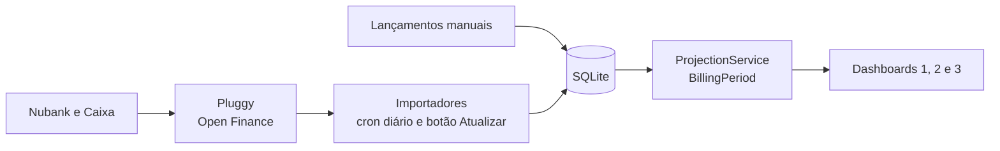
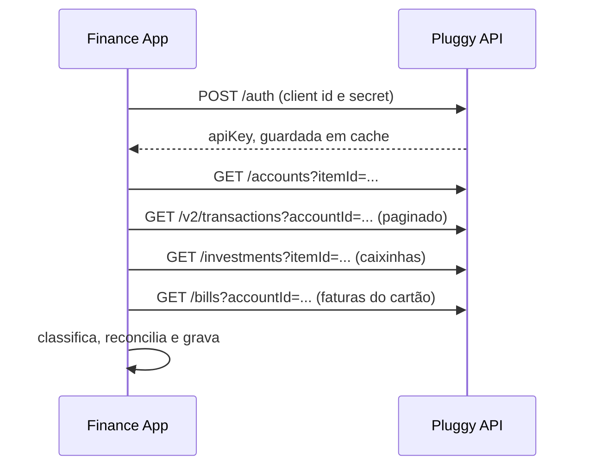
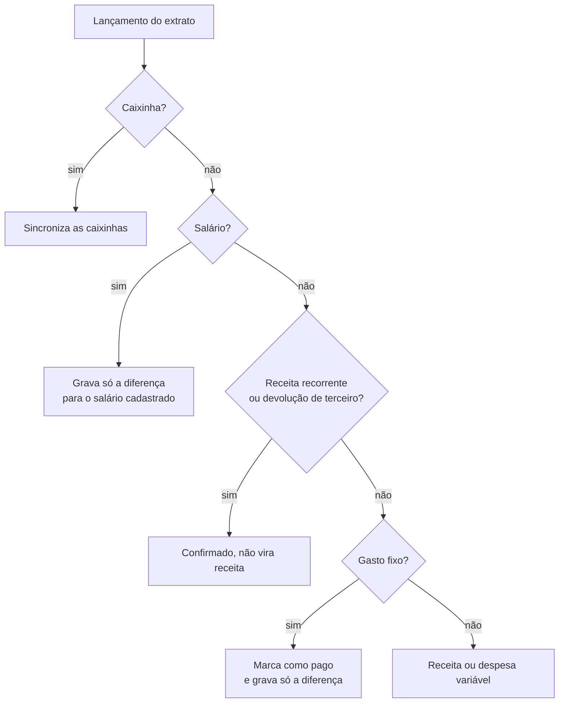
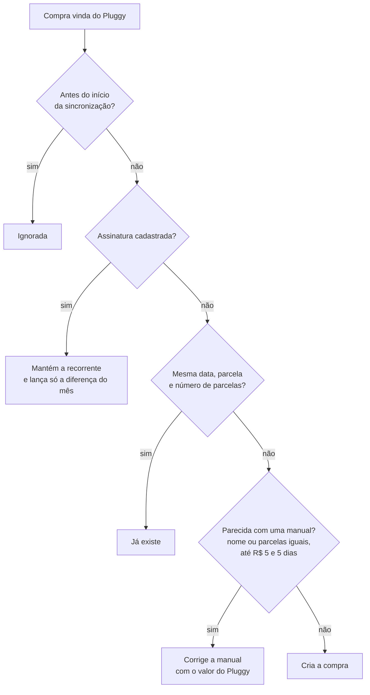

# Finance App

Finanças pessoais olhando para frente: período a período, quanto da receita já está comprometido e quanto vai sobrar na conta.

O período vai do último dia útil do mês, quando o salário cai, até o penúltimo dia útil do mês seguinte, considerando fins de semana e feriados nacionais.

## O que faz

- Projeta o saldo em conta ciclo a ciclo: salário, receitas recorrentes, gastos fixos, faturas de cartão, gastos variáveis e o rendimento das caixinhas.
- Importa conta e cartões pelo [Pluggy](https://pluggy.ai) (Open Finance), sem duplicar o que foi lançado à mão.
- Mostra a projeção em três dashboards. O Dashboard 3 traz os gráficos interativos de saldo e de entradas e saídas.
- Mantém compras feitas para outra pessoa registradas, mas fora dos cálculos.

## Como os dados fluem



Os dashboards nunca chamam o Pluggy. Eles leem o saldo gravado na última importação.

## API do Pluggy



## Cada lançamento da conta



## Compras do cartão sem duplicar



O saldo de cada ciclo é o saldo do ciclo anterior, mais as entradas, menos as saídas, mais o rendimento das caixinhas. O ciclo atual parte do saldo real e soma só o que ainda falta acontecer.

## Stack

Laravel 13 (PHP 8.3), SQLite, Bootstrap 5 e Docker Compose.

## Rodando

```bash
make setup          # primeira vez: .env, containers, dependências e banco
make up             # app em http://localhost:8080
```

Gere a senha de acesso com `php artisan app:password` e cole o resultado em `APP_PASSWORD_HASH`, no `.env`, **entre aspas simples**. Para importar do Pluggy, preencha as variáveis `PLUGGY_*`.

| Comando | Para quê |
|---|---|
| `import:pluggy-nubank` | Movimentação da conta e caixinhas |
| `import:pluggy-caixa-card` | Compras do cartão (`--dry-run` mostra sem gravar) |
| `pluggy:connect` | Conecta uma instituição e devolve o `itemId` |

## Testes

```bash
php artisan test    # SQLite em memória, sem container
```

## Deploy

Passo a passo em [DEPLOY.md](DEPLOY.md).
